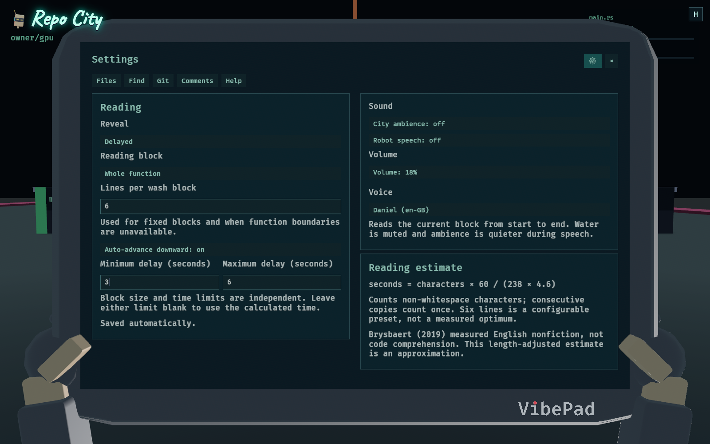

# Repo City

[Repo City](https://repo-city.meta-uber-engineer.dev/) opens GitHub repositories
and pull requests as a 3D city in your browser. **Vibe City** opens local Git
checkouts on desktop, including live worktrees, an integrated terminal and
local review notes shared through MCP.

Directories become districts; files become buildings with source, diff, and
blame walls. Both applications use the same Rust engine in this workspace.
Licensed under **MIT OR Apache-2.0**; choose either license.



## Workspace

- `crates/repository` owns repository snapshots, comparisons and source analysis (`repo-world`).
- `crates/game/src/repo_city/lib.rs` exposes the shared engine as `repo_city_core`.
- `repo-city` is the browser entry point; `vibe-city` is the desktop entry point.
- `web` supplies browser storage, GitHub access and speech through a service bridge.
  Bevy renders the tablet screen and widgets on desktop and in the browser.

Use one release commit for the browser deployment and desktop packages.
Desktop adapters stay native-only; browser builds do not contain the local terminal.
The former `bobishh/vibe-city` repository is superseded by this workspace.

## Open a repository

### On your Mac

The desktop app is called **Vibe City**. Install Rust and CMake to build the app and its bundled Opus codec.

```sh
git clone https://github.com/bobishh/repo-city.git
cd repo-city
./scripts/build-macos.sh
open "dist/Vibe City.app"
```

Click the robot **Vibe City** logo and choose **Open local repository…**, or
press **Cmd+O**. The same menu opens **Revisions…**, **GitHub…**, and file search.
**Revisions…** lists branches, tags, and recent commits. You can view a commit
without switching your working tree. For terminal use, `./scripts/run-native.sh`
opens Repo City's checkout by default and accepts another checkout path as its
first argument.

Choose **Revisions… → Live worktree** to compare the working directory with
`HEAD`. Saves update changed buildings, and new non-ignored files appear in
the city. An update appears briefly above the city controls. Click it or press
**L** to fly to the last changed file. Press **Tab** to open the changed files
tablet and see earlier changes. Press **F** to show only changed buildings and
**G** at a changed file to read its diff. From the command line,
run `./scripts/run-native.sh /path/to/checkout --live`.
The script runs the Rust development build. The watcher updates the city when
the inspected checkout changes. Restart the program to load changes to Repo
City's own Rust code. The desktop tablet uses watcher times or file modification
times in a worktree and commit times for Git comparisons. The browser uses
GitHub commit history where available.

Choose **GitHub…** from the logo menu to find a repository or paste a GitHub repository or pull
request URL. **Sign in with GitHub** opens the verification page. Click the
device code to copy it, then paste it in the browser. Once signed in, the picker
suggests your repositories, forks, and starred repositories as you type.
Select a repository to choose a revision and comparison base or list its pull
requests.
The app uses Git to fetch snapshots and the GitHub API for review comments.

In large repositories the city loads nearby buildings as you fly. File search
still covers the entire comparison.

### On Linux or Windows

Both desktop ports require Git on `PATH` and a graphics driver supported by
Bevy: Vulkan on Linux, DirectX 12 or Vulkan on Windows. GitHub access uses the
app's sign-in flow; `gh` is not required.
On Linux and Windows, **Open local repository…** opens a path field inside
the app. Enter the checkout directory, then choose **Open**. You can also pass
`--repo /path/to/checkout --live` from a terminal.

On Debian or Ubuntu, install the native build dependencies before building:

```sh
sudo apt install build-essential cmake pkg-config libasound2-dev libudev-dev \
  libfontconfig-dev libwayland-dev libxkbcommon-dev libx11-dev libxkbcommon-x11-0
./scripts/build-linux.sh
```

The script creates `dist/VibeCity-<target>.tar.gz`. Extract it and launch
`vibe-city`; the package lists its runtime dependencies. Build with Rust 1.98
or newer. On Windows, install Rust with the MSVC toolchain, Visual Studio C++
Build Tools, CMake, and Git for Windows, then run:

```powershell
./scripts/build-windows.ps1
```

Extract the resulting `dist/VibeCity-x86_64-pc-windows-msvc.zip` and launch
`VibeCity.exe`. The Windows script accepts `-Target`, `-BuildProfile`, and
`-OutputDirectory`. The Linux script accepts `CARGO_BUILD_TARGET`,
`VIBE_CITY_BUILD_PROFILE`, and `VIBE_CITY_OUTPUT_DIR`; cross builds need a
matching C compiler and platform libraries. Both packages include license
notices. These build scripts do not add CI jobs.

Settings and local notes use `%APPDATA%/Repo City` on Windows and
`${XDG_CONFIG_HOME:-~/.config}/Repo City` on Linux. System voice speech and
secure sign-in restoration currently use macOS services; Linux and Windows
keep the GitHub session for the current app run.

### In your browser

Open [Repo City](https://repo-city.meta-uber-engineer.dev/) in a browser with
WebGPU. Paste an `owner/repository` name, a GitHub repository URL, or a GitHub
pull request URL. For a repository, choose a branch, tag, or commit from the
suggestions. Pick a comparison base to review a branch from its merge base.
With no base specified, Repo City compares the revision with its first parent.
The HUD labels this **Last commit**; its counter counts changed files whose diff
you opened. **F** filters this comparison in flight and in map views, including
ordinary repository URLs.
A pull request opens its head tree and highlights changed lines in place. The
diff wall also shows deleted lines. Paste a pull request URL or choose **Pull
requests** after selecting its repository. Closed and merged pull requests
show their historical changes and comments. Signed-in reviewers can annotate
open, closed and merged pull requests. Publishing requires GitHub write access
to pull requests and valid anchors on the PR's head revision.
Press **F** or choose **Only changes** from the right-click menu to lower
untouched buildings below the street and filter the file picker. Press **F**
again or choose **Show all files** to restore the full city.

Use **Sign in with GitHub** below the search to find your repositories, stars,
and forks from the repository field. Under your GitHub handle, use **Choose
private repositories** to grant read access to selected repositories. Use
**Default branch** or **Compare…** to find branches and tags or search commit messages
on the default branch. Click the **Repo City** logo to reopen the picker.
The first city visit offers a controls tour. Open **H** to take it again.

## Controls

| Action | Control |
| --- | --- |
| Find a file by name or path | **P** in the browser, **⌘P** on Mac |
| Preview a document or image | Aim at its building and press **P**. VibePad renders Markdown, plain text and code, and raster images (formats below). |
| Fly | **WASD**, **Space** and **Ctrl** for altitude, **Shift** to boost |
| Capture or release the cursor | Click the scene to capture. **Esc** releases. |
| Use the actions menu | Right-click to open or close it. Scroll or use the arrow keys to highlight an action. Click or press **Enter** to select it. |
| See the city from above | Press **M** for the district, then the whole project. On the project map, click a district first, then a building. The cursor stays free in map views. **M** returns to your original view after a district jump. Fly freely after each move. |
| Return to a building | **Ctrl+O** goes back in jump history and **Ctrl+I** goes forward. |
| Browse changes | **Tab** opens and puts away VibePad. **Viewed** limits the list to changes you visited. Select a file to fly there. **Ctrl+Tab** moves to the next control; **Shift+Tab** moves to the previous one. |
| Approach a wall | Far away, left-click a building to fly to its nearest covered lines or the top of its source wall. Press **E** to fly to the aimed face. Scroll to move along the wall. |
| Thaw or paint lines | **0** equips the heat tool. Click close to a source wall to start or stop heating. Blurred code becomes clear while you aim at the block. In VibePad **Settings**, choose **Immediate** to save the reveal right away or **Delayed** to wait for the reading estimate. **1–9** equip paints; drag from one readable line to another on the same side of the file. |
| Edit paints and notes | **U** opens paints; **⌘ + scroll** cycles tools on Mac. **J** opens the note you are aiming at or the review list. |
| Find text on the current wall | **/** or **Find in file** in the actions menu. **Enter** keeps results; **N** and **Shift+N** visit matches. |
| Turn to the diff or blame wall | **G** for diff, **B** for blame. Up close, **Left/Right** cycles source, diff and blame. Sign in with GitHub for line attribution in the browser. |
| Follow a file’s changes | **C** starts the review. Scroll up or press **W** for the next stop. Scroll down or press **S** for the previous stop. **Q** returns to the diff wall. |
| Fold a code block | **Z** collapses the aimed function; **X** expands it. Fixed-line blocks are used when syntax boundaries are unavailable. |
| Open controls | **H** opens and puts away VibePad Help. Choose **Start tour** to practice flying and washing source. |

Source, diff and blame walls wrap long code to their available text width for
every language. Blame reserves space for attribution while history loads.
Continuation rows keep the original line number for notes, search and links.

**Reading block** chooses whole functions where syntax boundaries are available,
or fixed-line blocks. **Lines per wash block** sets the fallback/fixed block size
(default: 6). Set it to 1 to clear individual rows. **Auto-advance** smoothly
scrolls downward to the next unread block while water remains on. This setting is independent of the
delay bounds. Wrapped continuations count as displayed rows; the original
source line is saved as read only after all its continuations are cleared.
Reading a close diff, blame wall, or hunk stop uses the same timer and reveals only its visible source lines on the correct comparison side. Flying past or looking away does not complete a block.
Function blocks do not nest: an outer function owns its entire source interval,
including callbacks inside it. Moving between those lines keeps the same block
and reading estimate. Fixed fallback blocks stop at function boundaries.
Unread source remains visible through blurred glass, including its indentation and
syntax colors. The heat tool clears the current reading block; leaving an unfinished
block frosts it again. The countdown around the cursor shows the remaining reading
time. Completed reading persists; unfinished time pauses and resumes within the session.
The compact heater and its short warm pulse leave the code clear of a water stream.

Accepted agent navigation and comment **Fly to line** actions open the target range
immediately. A warm highlight fades after arrival; showing code does not mark it read.
Native **Follow agent** opts into navigation from explicit file activity. **Source
always visible** in Settings shows all code while retaining separate reading progress.

Delayed mode estimates seconds as `effective non-whitespace characters × 60 / (238 × 4.6)`
for the selected block. Consecutive copies of one character count once, so a
decorative separator does not create a long delay. This repetition discount is
an interface heuristic, separate from the cited prose reading rate. A minimum or maximum delay clamps that result; clear
either field to remove that bound. The initial bounds remain 3 and 6 seconds.
The length-adjusted [Brysbaert English nonfiction rate](https://doi.org/10.1016/j.jml.2019.104047)
is an approximation, not a measured code-comprehension speed. Six rows is a
configurable preset, not a research-backed optimum. The Mac stores `mode`,
`block_lines`, `block_kind`, `auto_advance`, `min_seconds`, and `max_seconds` in
`~/Library/Application Support/Repo City/reading.json`. A `null` bound has no limit.

Reach the end of a Markdown or text preview to reveal the file's source wall.
**P** also opens extensionless documents such as `UPSTREAM-LICENSE` and files
with unknown extensions as plain text. Binary and non-UTF-8 data show an error
inside VibePad. The image viewer supports PNG, JPEG, WebP, GIF, BMP, ICO,
TIFF (`.tif` / `.tiff`), TGA, PNM (`.pnm`, `.pbm`, `.pgm`, `.ppm`, `.pam`), QOI,
DDS and Radiance HDR (`.hdr` / `.rgbe`). GIF previews show the first frame.
HDR and 16-bit images use an 8-bit display preview. DDS support covers DXT1,
DXT3 and DXT5 textures; unsupported layouts show a decoding error. SVG remains
available as text. All raster formats use the same bounded Rust decoder on desktop
and in the browser: 16 MiB input, 8192 pixels per side and 16 megapixels total.
Repo City saves revealed lines and reviewed files in IndexedDB in your browser or
SQLite on your Mac. Reading ranges carry their source content identity. After edits,
only uniquely matched unchanged lines retain prior read credit; new or ambiguous
lines remain frosted. The same repository and comparison restore those marks. Press **V** to
toggle the selected file’s review mark. To start over on the open comparison,
choose **Reset progress** in the browser’s repository dialog or the Mac
**Files** menu.

The city shows counts and progress bars for visited files and changed files
whose diff you opened. In the browser, a pull request or branch update keeps visits to
unchanged file contents and diffs.

## Follow file connections

Open **Tab → Connections** while focused on a file. VibePad lists its imports
and resolved local targets; select a target to fly to its definition line.
When only the module is known, the target says **module start**. Roads connect
resolved files in the visible city. Following a link restores hidden buildings
if **Only changes** would hide the destination.

The native resolver supports static JavaScript/TypeScript imports and Rust
modules and qualified imports. External packages and ambiguous targets remain
listed with an explanation. This is syntax-based navigation, not a compiler
call graph. Parsing runs in a background worker and its in-memory cache uses
language and content identity.

## Follow a pasted trace

Open **Tab → Trace** in either application. Paste a stack trace or JSON export, choose
**Build route**, inspect the resolved frames and any unresolved locations, then
choose **Follow trace**. This works for local worktrees, commit snapshots and
GitHub pull requests without requiring write access. **W/S** visits the next or
previous frame; **Esc** leaves the route. **T** starts the imported trace again.

The importer accepts `path:line` and `path:line:column`, including common Ruby,
Python, JavaScript, Rust and Elixir stack formats. It preserves frame order and
repeated calls. Absolute paths can match by repository path suffix; the preview
labels those matches. A bare filename must identify exactly one file. Missing
or ambiguous paths remain listed and do not become route steps. Source line
availability is checked when each frame opens. Traces are limited to 64 KiB
and 128 frames or spans and stay in the current application session. Switching the
repository or comparison clears them; a worktree update stops an active route
so it can be rebuilt against the updated files.

The same field detects these JSON formats:

- **OpenTelemetry OTLP:** `resourceSpans[].scopeSpans[].spans[]`, older
  `instrumentationLibrarySpans`, or a top-level `spans` array. Source attributes
  are `code.file.path` and `code.line.number`; the older `code.filepath` and
  `code.lineno` names also work. Parents precede children, with start times
  ordering independent spans. Nanosecond timestamps produce millisecond durations;
  names, parent IDs and error status remain visible. See the
  [OTLP example](https://github.com/open-telemetry/opentelemetry-proto/blob/main/examples/trace.json)
  and [source attributes](https://opentelemetry.io/docs/specs/semconv/registry/attributes/code/).
- **Chrome Trace:** a `traceEvents` object or event array, using complete `X`,
  synchronous `B`/`E`, or nestable async `b`/`e` duration events. Source coordinates
  can use the same code attributes, `args.file` / `args.line`, or Blink
  `args.data.url` / `lineNumber` (one-based). Explicit Runtime `callFrame`
  locations are converted from zero-based lines. Microsecond timestamps and
  durations are converted to milliseconds. Metadata, counters and other phases
  do not become steps. See the [Chrome JSON format](https://perfetto.dev/docs/getting-started/other-formats#chrome-json-format).

Choose a trace ID, thread or async scope when an export contains several.
Routes follow only the selected group. Chrome steps use timestamp order within
that group; they do not imply a call graph. Spans without source coordinates or
matching files remain listed as unresolved. Malformed JSON, duplicate OTel span
IDs within one trace and parent cycles stop route creation. Exported names alone
are not used to guess source locations.

## Edit a private source draft

Aim at a text or code file, press **P**, then choose **Edit**. VibePad edits only
the current reading chunk, selected by the same function or fixed-line settings
as washing. The full document remains available in preview. VibePad uses the
same editor on desktop and in the browser. Syntax colors and mathematical glyph
fallbacks are shared with source walls. Browser grammars load on demand.

Typing autosaves a private draft on the current device, scoped to the repository,
revision, comparison side, file, original blob and source chunk. Closing VibePad or reopening
the same snapshot restores it. **Cmd/Ctrl+S** flushes the same draft; it does not
create a commit or publish to GitHub. **Copy**, **Paste**, **Undo**, **Redo** and
**Discard draft** are available in the editor. **Ctrl+]** inserts four spaces;
**Tab** still puts VibePad away. **F6** switches between the editor and controls.
Arrow keys, selection, Home/End and Page Up/Down stay inside the focused editor.
**Cmd/Ctrl+F** focuses Find in file. Enter, Previous match and Next match open
the matching source chunk immediately and preserve the query. **/** remains literal
text inside the editor. On a wall, **/** searches and **Enter** opens its matching
chunk for editing without waiting for a flight.

On a live desktop worktree, **Apply to file** explicitly replaces only the original
source interval with the edited chunk and preserves the rest of the file.
It refuses paths through symbolic links and refuses to overwrite a file changed
outside VibePad. Commit snapshots, pull requests and browser drafts keep their
original source unchanged; use **Copy** to take edits elsewhere. Commit and push
are separate Git operations and are not performed by this editor.

Editing is limited to 256 KiB per chunk. Undo history is bounded and is not saved
across reopening; source drafts are. Caret movement uses Unicode scalar values,
so complex grapheme clusters and bidirectional editing are not fully supported.
If local storage fails, the editor shows an error and retains the current chunk
when navigation would abandon it. Unsaved text also survives putting away and
reopening VibePad in the same app session. Copy changes before reloading or exiting
when storage remains unavailable.
Desktop drafts live beside preferences in `source-drafts`; browser drafts use
local storage. Clearing application or site data removes them.

The browser build needs a C compiler supporting WebAssembly for the small
`stb_textedit` adapter. On macOS, install LLVM with Homebrew; the build selects
`/opt/homebrew/opt/llvm/bin/clang` when no C compiler override is set. Other
platforms can set `CC_wasm32_unknown_unknown` to a compatible Clang.

## Talk to a coding agent

On desktop, choose **Settings → Agent provider** in VibePad, then open **Agent**
to connect to the locally installed Codex, Agy (Antigravity), or Grok CLI.
Sign in with that CLI first. City keeps a separate conversation for each
checkout and provider. Agy requires a CLI with `agy acp`; Grok uses
`grok agent stdio`. Agy and Grok stream text and ask before tool calls that
require permission. Voice and steering are available with Codex.
Enter a message and choose **Send**, or press **Cmd/Ctrl+Enter**. During an active
Codex turn, **Steer** sends new instructions into that same work.
City saves the message locally and shows **Sending** until Codex confirms delivery.
If another client owns the saved conversation, City forks its history and delivers
the queued message in the independent conversation. **Restore message** copies the
most recent rejected or unconfirmed message into an empty composer for manual review.
Requested command and file permissions appear in the same tablet with
**Approve once** and **Reject**. **Stop work** interrupts the current turn.

Choose **Start voice** in VibePad or press **F9** while flying (some Macs use
**Fn+F9**). **Connect chat** starts the text connection separately. The app
requests microphone access only after that action. If a turn is running, voice
waits for it to finish; **F9** cancels that pending start. The HUD shows a drawn
microphone, connection animation and speaking bars while VibePad is put away.
Voice requires Codex
app-server realtime support and uses native audio devices. The microphone pauses
while the agent speaks; use headphones. **F9** stops voice, and **Disconnect**
closes the agent connection. Putting away VibePad keeps the conversation active.
**H** lists the voice and terminal controls. City audio pauses for the voice conversation.
The native transport uses Opus at 48 kHz with 20 ms microphone frames. A short
playout buffer and packet-loss recovery smooth network bursts. The session retries
transient connection loss after 1, 2 and 4 seconds, then stops after three early
failures. F9 cancels pending reconnects. It does not support interrupting the agent
by speaking over it.

The agent receives the selected repository context and can read camera focus and
local notes through Repo City's MCP tools. Focus reports whether the window is
active; it is not eye tracking. Public tool events with explicit file paths
draw blue beacons at those buildings, including activity from identified child
agents. Unresolved activity is not assigned to a guessed building.
Paths such as `crates/explorer/build.rs:12` are highlighted inside chat; click
to fly to that file and source line. The MCP tool `propose_navigation` shows a
notification with **Y · Fly** and **N · Dismiss**. Proposals expire after a minute
and never move the camera without acceptance. Y/N remain text while an editor,
message field or terminal has focus.

Agent sessions use a shared engine contract for commands, normalized conversation
state, capabilities and lifecycle events. The Codex adapter owns its authentication,
app-server messages and native media. The Agy and Grok adapters use ACP over stdio.

The local dialogue view and conversation ID persist beside preferences in
`agent-conversations`. Codex manages the underlying agent conversation. This
integration is native-only; the deployed browser does not start local agents.

## Sound and preferences

The gear at the right of VibePad's navigation opens **Settings**. Valid changes save automatically; invalid fields show a reason and keep the last valid settings. Set the water
reading delay there, mute the city, adjust volume, or turn robot speech off.
Sound and narration start disabled. Wind, spray, construction, and occasional sirens are synthesized locally when enabled.
Choose **Radio** in Sound settings for **Space trance** or **Techno**. Each station
synthesizes a continuous mix locally and evolves its bass, arpeggios, and drums
every two bars. Both stations build toward a drop and ease into a breakdown as
their harmonies and lead motifs change. Radio starts off and works independently
of city ambience. Both become quieter during narration.
The browser starts its AudioWorklet after the first click or keypress. Preferences
persist on the device; opening the repository picker or hiding the page silences it.
The robot reads the current readable block from start to end, in source order.
Choose an installed local voice in Settings; the default prefers Daniel.
Water is muted and other city sounds are quieter during speech. Leaving the
block lets the current utterance finish; mute, opening a menu, or hiding the
application stops speech. macOS uses system voices; desktop speech is currently
unavailable on Linux and Windows. Browser voice availability depends on installed
local voices.

On desktop, **File changes** plays a short chime for coalesced local source saves,
additions and deletions. It starts disabled, shares Volume/Mute, and waits for
narration or an agent voice conversation to finish. Refreshing identical content
or committing already-saved bytes does not replay the chime.

## Git history and terminal

Open **Tab → Git** to browse commits and inspect their patches. Pick **Before**
and **After**, then **Compare selected commits** to open those exact snapshots
without checking out either commit. The browser uses GitHub history; it does not
expose a local terminal.

On desktop, **Tab → Terminal** opens a persistent shell in the current checkout.
It uses Alacritty's terminal emulator and a real PTY, including cursor movement,
alternate screens, UTF-8, resizing, clipboard paste and Ctrl+C. **Ctrl+Tab** puts
away the tablet while the shell keeps running; plain Tab and Esc go to the shell.
**F6** switches keyboard focus between the shell and tablet controls.
Exiting the shell starts a new session in the same checkout. Five consecutive
exits within two seconds of startup pause automatic restarts, including failed
launches. Close and reopen VibePad, or choose **Restart shell**, to retry.
Shell commands run in the inspected repository and may change it. Git history
and comparison controls only read it. If Git is missing, install it and restart
the app; the tablet shows installation guidance rather than closing the app.

Without a mouse, **arrows** turn the camera in flight. Near a wall, **Up/Down**
scrolls and **Left/Right** changes its face; hold **Shift** for free look. **K**
uses the selected tool: tap to toggle water or hold to paint.

**Alt+0** opens repository selection. **Shift+F10** opens the actions menu.

In VibePad, **Alt+1…6** selects a tab in its displayed order. Arrow keys move
focus, **Enter/Space** activates a control, and **Esc** goes back or closes the
panel. **Tab** puts VibePad away; **Shift+Tab** moves focus. Text fields and the
terminal keep their editing keys. **Cmd/Ctrl+P** opens Find in VibePad.

## Touch controls

The browser shows separate movement and look sticks and icon buttons on devices with a coarse
pointer. Drag the city to look around. Near a readable wall, swipe vertically to
scroll and sideways to cycle source, diff, and blame. Moving the joystick
leaves the wall.
Use Up, Down and Fast to fly; altitude buttons hide while reading. **Pad** opens
VibePad, and the top-right cross puts it away. Controls reset when a menu opens,
the page loses focus, or a touch is cancelled. A WebGPU-capable browser and GPU
remain required. Landscape provides more reading space.

## Leave review notes

Wash the source or use the readable diff wall. Pick a paint with **U** and
drag over lines to color them and save a draft with that paint's reusable
prompt. Each draft keeps its original file, revision, and line range.
Change a paint's name, color, spray text, or reusable prompt in **Paints**.

The Mac app saves notes and palettes in SQLite. Press **J** while aiming at a
marked line to open its comment in VibePad. Away from a mark, **J** opens all
comments on the current comparison. **All comments** returns to that list.
Use **Edit** on a note to add details, then **Save**. Worktree notes are
saved locally and available through MCP immediately; **Publish** applies only
to GitHub pull requests. **Copy** copies a note without exporting a file.
An empty paint slot equips a plain note without a required prompt.
Comment previews render Markdown in VibePad.
When you open a GitHub pull request, **J** also lists its review comments.
Choose **Fly to lines** to see an anchored comment on its building, or
**Open on GitHub** to read the full thread. In the **M** overview, gold pins
mark buildings with comments on the current comparison.
In a pull request, **Publish all** sends the current drafts to GitHub
with write access. Turn on **Auto-publish** to send new marks as you make them.
This setting turns off when you open another comparison. GitHub sign-in uses
the macOS Keychain to restore the session.

In the browser, sign in with GitHub to save drafts for a pull request in
IndexedDB. Press **J** while aiming at a note to open it. Existing public
review threads are readable without signing in.
Choose a local paint for a GitHub thread from its detail panel. GitHub still
shows the original comment. Signed-in reviewers can show resolved threads from
the review list.

The draft starts with the paint's reusable prompt. **Publish to GitHub**
sends that comment in one action. Use **Edit comment** to adapt it or
**Write a comment** to start blank. Publication requires repository access
and **Pull requests: write** for the Repo City GitHub App. Select **Suggest
replacement** on the current side of a pull request to preview and publish
replacement code. GitHub accepts suggestions within one diff hunk. If the
PR moves or GitHub rejects the range, the draft stays local. Resetting
reading progress leaves notes and paints in place.

On a signed-in review, unresolved inline comments that mention your GitHub
handle are marked in gold until you view them. Open **Review notes** and
choose **Fly to next mention**. Click the city to capture the cursor and
press **J** once the camera reaches the marked lines.
**Mark as viewed** adds an eyes reaction from your GitHub account, without changing
the comment text, and restores
the thread's usual color when you have marked its mentions viewed. Local checkout
notes use the same button to save their viewed status for MCP without a GitHub reaction.

For local stack traces, draft editing, builds, and deployment, see
[Development](docs/development.md).

### Share local review notes with an MCP client

Run the native binary with `--notes-mcp --repo /absolute/path/to/checkout`
as a stdio MCP server. `list_notes` reads private local notes from both commits and live worktrees in that
checkout. Each note includes its revision and comparison base. `mark_note` sets a note to `unread`, `read`, or `addressed`.
`get_focus` returns the current file, wall side, camera, and the source lines
that are visible and readable. `list_notes` includes the same focus context.
Context expires after six seconds. Source, diff and blame report visible lines on
their actual comparison sides. Focus includes the source blob for stale-content checks.
`create_note` writes a private local note with `id`, `revision`, `path`, `line`,
optional `end_line`, `before`, `text` and optional `expected_blob`. New notes appear
in the running native city. Identical retries preserve their local status; conflicting
reuse of an id fails. `propose_navigation` accepts `line` and optional `end_line`;
the city flies and reveals the range only after **Y** or **Fly**. **N** dismisses it.
Creating a note never moves the camera. Replace the MCP executable and restart the
server after updating the app to expose new tools.
An addressed note stays in the review list and its paint disappears from
the city. Local note tools do not publish to GitHub.

## License

Choose the [MIT license](LICENSE-MIT) or [Apache License 2.0](LICENSE-APACHE).
See [third-party notices](THIRD_PARTY.md) for separately licensed material.
