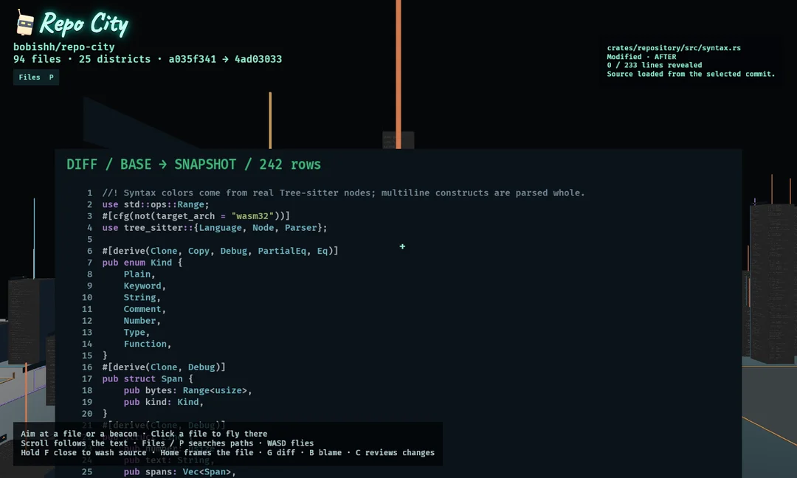

# Repo City

Repo City turns a Git repository into a 3D city you can fly through. Directories
form districts. Each file has walls for its source, diff, and blame. Open a
GitHub pull request to see what it changes in the context of the whole codebase.

[Explore Repo City’s own code in your browser](https://repo-city.meta-uber-engineer.dev/?repo=bobishh%2Frepo-city&ref=4ad0303336c2acf0ea785c596dbc0b5d53d55bfe&base=a035f34156d434e22142a6104b812f3bb6f13b36).
The demo opens at `crates/repository/src/syntax.rs`. Press **G** to see its
diff, or press **P** to find another file.



## Open a repository

### In your browser

Open [Repo City](https://repo-city.meta-uber-engineer.dev/) in a browser with
WebGPU. Paste an `owner/repository` name, a GitHub repository URL, or a GitHub
pull request URL. For a repository, choose a branch, tag, or commit from the
suggestions. Pick a comparison base to review a branch from its merge base.
With no base specified, Repo City compares the revision with its first parent.
A pull request opens its head tree and highlights changed lines in place. The
diff wall also shows deleted lines. Paste a pull request URL or choose **Pull
requests** after selecting its repository.

Use **Sign in with GitHub** below the search to find your repositories, stars,
and forks from the repository field. Under your GitHub handle, use **Choose
private repositories** to grant read access to selected repositories. Use
**Default branch** or **Compare…** to find branches and tags or search commit messages
on the default branch. Click the **Repo City** logo to reopen the picker. Use **?** to start the interactive controls tour again.

### On your Mac

Build the app with Rust and open the resulting bundle.

```sh
git clone https://github.com/bobishh/repo-city.git
cd repo-city
./scripts/build-macos.sh
open "dist/Repo City.app"
```

Click **Open Repository…** or press **⌘O** and pick a local Git checkout.
**Revisions…** lists branches, tags, and recent commits. You can view a commit
without switching your working tree. For terminal use, `./scripts/run-native.sh`
opens Repo City's checkout by default and accepts another checkout path as its
first argument.

## Controls

| Action | Control |
| --- | --- |
| Find a file by name or path | **P** in the browser, **⌘P** on Mac |
| Fly | **WASD**, **Space** and **Ctrl** for altitude, **Shift** to boost |
| Capture or release the cursor | Click the scene to capture. **Esc** releases. |
| Open the actions menu | Right-click to open scene actions, file search, paints, or review notes. |
| See the district from above | **M** toggles district view. Hover for a file name, then click or press **E** to fly there. |
| Approach a wall | Far away, left-click a building to fly to its nearest covered lines or the top of its source wall. Press **E** to fly to the aimed face. Scroll to move along the wall. |
| Wash or paint lines | **0** equips water. Hold left click close to a source wall to reveal lines. **1–9** equip paints; drag from one readable line to another on the same side of the file. |
| Edit paints and notes | **U** opens paints; **⌘ + scroll** cycles tools on Mac. **J** opens the note you are aiming at or the review list. |
| Find text on the current wall | **/** or **Find in file** in the actions menu. **Enter** keeps results; **N** and **Shift+N** visit matches. |
| Turn to the diff or blame wall | **G** for diff, **B** for blame. Sign in with GitHub for line attribution in the browser. |
| Follow a file’s changes | **C** starts the review. **W** and **S** move between change platforms. |

Repo City saves revealed lines and reviewed files in your browser or on your
Mac. The same repository and comparison restore those marks. Press **V** to
toggle the selected file’s review mark. To start over on the open comparison,
choose **Reset progress** in the browser’s repository dialog or the Mac
**Files** menu.

## Leave review notes

Wash the source or use the readable diff wall. Pick a paint with **U** and
drag over lines to save a draft. To add details, aim at a marked line and
press **J**. Each draft keeps its original file, revision, and line range.
Change a paint's name, color, spray text, or reusable prompt in **Paints**.

The Mac app saves notes and palettes in SQLite without a GitHub login.
Choose **Review notes** from the right-click menu to reopen or export them.
In the browser, sign in with GitHub to save drafts for a pull request in
IndexedDB. Existing public review threads are readable without signing in.

**Preview GitHub comment** shows the text before you send it. Publication
requires repository access and **Pull requests: write** for the Repo City
GitHub App. If the PR moves or GitHub rejects the range, the draft stays
local. Resetting reading progress leaves notes and paints in place.

For local stack traces, draft editing, builds, and deployment, see
[Development](docs/development.md).

## License

Choose the [MIT license](LICENSE-MIT) or [Apache License 2.0](LICENSE-APACHE).
See [third-party notices](THIRD_PARTY.md) for separately licensed material.
